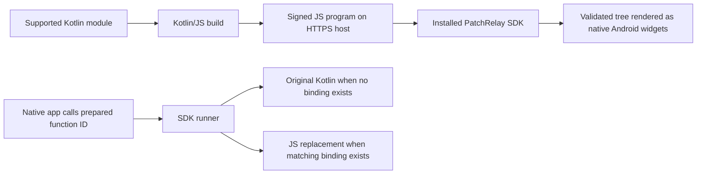

# PatchRelay

An experimental Android SDK for updating **supported Kotlin-authored screens and prepared function logic** through signed, interpreted JavaScript programs.

PatchRelay is intended to be a dependency inside a developer's app. The included app is a test host, not the product. Developers keep writing supported Kotlin; Kotlin/JS compiles the patch module, and the installed SDK executes it.

**Status:** working prototype, verified on one RMX2117 / Android API 31 phone. Not a general Kotlin/Compose hot-patcher, not production-ready, and not published on Maven Central.

## Read the docs

| Guide | Contents |
| --- | --- |
| [Developer integration](docs/integration.md) | What developers must change, actual SDK APIs, lifecycle, Back and function hooks |
| [Architecture and flows](docs/architecture.md) | Build/runtime diagrams, contracts, trust, compatibility and recovery |
| [Build and publishing](docs/release-workflow.md) | Base → patch → GitHub channel, personal hosting, SDK distribution |
| [Verification and remaining work](docs/production-readiness.md) | Current phone evidence, historical versions, test matrix and limits |
| [Historical API-2 test](docs/api-2-phone-verification.md) | Archived 0.2.0 form/cursor proof; not the current integration guide |

## What we are building



The first APK must include the SDK, original program and required native hooks. Installing the dependency alone does not make existing functions or Compose screens patchable.

| Supported now | Boundary |
| --- | --- |
| Columns, rows, cards, styled text, inputs, checkboxes and enabled controls | Installed renderer's supported widgets only |
| Program-managed Cart → Details → Review → Receipt flow | Inside a registered screen; not Android Navigation/Compose conversion |
| Stable view IDs, input updates, ordered/coalesced events | Screen state lives in memory; no durable restoration |
| Android Back routes declared by the program | Requires host Back integration, included in the 0.4.0 demo |
| Native fallback or JS replacement selected by stable function ID | Handwritten callback hooks; only `(Int, Int) -> Int` |
| Signed staging, exact host compatibility and startup fallback | Recovery is bounded; no business-data rollback or rollout service |

No downloaded DEX/JAR/native-library updates are used. Assets, dependencies, permissions, installed renderer/SDK changes and unsupported native capabilities are outside the patch scope.

## Current example

| Item | Value |
| --- | --- |
| App | PatchRelay Screens — `dev.patchrelay.screens.demo` |
| Base APK | 0.4.0 / version code 4 |
| Compatibility ID | `native-back-v1` |
| Runtime / screen API / manifest schema | `kotlin-screen-js` / 2 / 3 |
| Base APK and patch 1 | [native-back-v1-patch-1](https://github.com/jaypal1046/patchrelay/releases/tag/native-back-v1-patch-1) |
| Polled channel | [native-back-v1/patch.json](https://github.com/jaypal1046/patchrelay/releases/download/native-back-v1/patch.json) |
| Verified runtime commit / CI | `b251eb0` / [passing build](https://github.com/jaypal1046/patchrelay/actions/runs/41062087592) |

The bundled baseline is a simpler checkout with original native calculation `3 + 100 = 103`. The patch adds the multi-page flow and binds `checkout.total.v1` to multiplication, returning 300. An unpatched shipping helper still returns 15 through Kotlin. Payment confirmation is local demo state, not a real payment.

Phone checks passed download/activation, native/JS routing, forms, navigation, state retention within the running program, keyboard dismissal and system Back. One authorized native APK update installed Back support; the subsequent flow download kept that APK hash and install timestamps unchanged.

## Repository layout

| Path | Purpose |
| --- | --- |
| `sdk/` | Android library: updater, verifier, interpreter, renderer and function runner |
| `screens/` | Example patchable Kotlin module and screen-building helpers |
| `demo/` | Example native host, pinned public key, bundled program and base snapshot |
| `tools/` | Project-specific build/sign/publish commands and checks |
| `runtime.json` | Example app/base identity, channel, screen IDs and compatibility inputs |
| `channels/` | Signed manifest audit copies; the app polls GitHub Releases instead |
| `docs/` | Integration, architecture, publishing and verification |

Only `:sdk`, `:screens` and `:demo` are active Gradle modules. Retired local generated directories, if present, are not part of the product. Signing keys stay in ignored `.keys/`; local test captures/build outputs stay in ignored `.tools/` and `dist/`.

## Build and check

Requires JDK 17, Android SDK 35, Python 3, Node 22+ (CI uses 22) and an installed Android WebView provider. Gradle 8.9, AGP 8.6 and Kotlin 1.9.23 are pinned. Android minimum API is 26. No npm runtime dependency is needed.

From the repository root in PowerShell, with JDK/SDK configured:

```powershell
.\gradlew.bat :screens:jvmTest :screens:compileProductionExecutableKotlinJs :sdk:testDebugUnitTest :sdk:assembleRelease :demo:assembleRelease --max-workers=2
node tools/test-screen-program.mjs demo/src/main/assets/baseline-screen.js baseline
node tools/test-screen-program.mjs screens/build/compileSync/js/main/productionExecutable/kotlin/PatchRelayScreens.js fixed
python tools/test_screen_build.py
python tools/screens.py check-host
```

SDK output: `sdk/build/outputs/aar/sdk-release.aar`. Demo output: `demo/build/outputs/apk/release/demo-release.apk`. The demo uses a development signing key.

The committed asset/snapshot describe the baseline; current Kotlin source describes the patch. Do not overwrite the asset or snapshot during a patch build. Follow the [release guide](docs/release-workflow.md) to reproduce a base safely.

## Where to publish

- **Developers' original apps:** their normal Android distribution channel.
- **Signed patches:** GitHub Releases or a personal HTTPS server.
- **PatchRelay dependency:** a local module/AAR today; Maven Central is a future distribution target, not configured or published.
- **Source and tools:** this GitHub repository; no public compiler-plugin/CLI package exists yet.

GitHub stores bytes; the device verifies signatures, compatibility and hashes before activation. No PatchRelay-owned hosting service is required.

Store eligibility has not been established. The interpreter design is not a guarantee of Google Play approval; see [distribution limits](docs/production-readiness.md#distribution-and-security).
