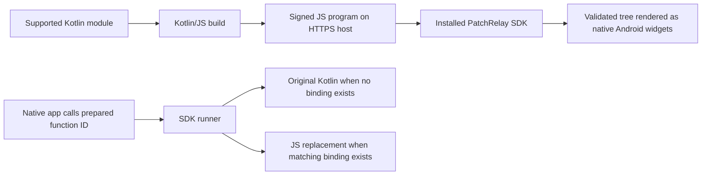

# PatchRelay

An experimental Android SDK for updating **supported Kotlin-authored screens and prepared function logic** through signed, interpreted JavaScript programs.

PatchRelay is intended to be a dependency inside a developer's app. The included app is a test host, not the product. Developers keep writing supported Kotlin; Kotlin/JS compiles the patch module, and the installed SDK executes it.

**Status:** working prototype, verified on one RMX2117 / Android API 31 phone. Not a general Kotlin/Compose hot-patcher or production-ready. Maven SDK publication and the first npm CLI publication have been submitted; public availability must be verified after registry processing.

**SDK license:** [PatchRelay SDK License — Binary Use](LICENSE). Proprietary SDK;
royalty-free integration in free/commercial apps, with implementation source private.

Local [Maven packaging and R8 setup](docs/maven-publishing.md) are now configured. Release SDK AARs are obfuscated before packaging; implementation source and private mappings are excluded from publication. These build changes invalidate the earlier native fingerprint: regenerate the unpublished base snapshot before building another matching patch. The installed phone app is unchanged.

The new [Gradle plugin](docs/gradle-integration.md) now records exact APK/AAB
baselines during normal release builds. Actual local builds and repeat-record
reuse pass. Records live privately under `.patchrelay/releases/baselines/`;
`demo/release-baseline.json` remains a legacy snapshot, not the automatically
selected current base. Patch selection stays explicit.

Signed [update catalogs](docs/update-routing.md) now route by app, channel and
exact native build. The CLI authors catalogs locally; the prepared demo can check
them silently after healthy rendering. Native SDK integration/new base is required;
older installed APKs do not gain catalog support through a JS patch.

Working source now targets **0.8.0 / `native-store-v1`**, an unpublished base with failed-state-commit restoration, plus the earlier sandbox/API/recovery hardening. The main phone app remains the tested 0.7.0 build. The new storage fix passed background-only tests in the isolated SDK package: failed commits and unwritable patch storage preserve selection and allow retry; an actual HTTPS read interrupted after 32 bytes closes its connection and a subsequent full request succeeds. Device storage was not filled and connectivity was not toggled. Installed SDK changes require a new base APK; old channels stay unchanged.

Recovery probes now also pass on that phone: signed startup failure → executing previous program, replay refusal, injected interrupted/corrupt downloads, saved-file tampering, persistent disable/re-enable and actual WebView renderer termination followed by a working replacement interpreter. Native request queues are bounded even when a client ignores cancellation. These are isolated SDK tests; main-app process-death/state restoration and memory-exhaustion coverage remain unfinished.

The host keeps failed candidates hidden and recovers without patch-error banners or raw exception text. Its two headless UI regression tests pass alongside 34 SDK tests. Every historical phone fault case returned to a checkout where Add item and the local demo Pay still worked. The separate security-check Activity is a test fixture, never an SDK update screen. The local 0.7.0 build is installed on the phone; new catalog/upgrade checks are local automated evidence, not a fresh phone test. Source has not been pushed; SDK/CLI registry publications are now processing. No hard JS heap quota or complete sandbox-escape proof is claimed.

## Read the docs

| Guide | Contents |
| --- | --- |
| [Developer integration](docs/integration.md) | What developers must change, actual SDK APIs, lifecycle, Back and function hooks |
| [Architecture and flows](docs/architecture.md) | Build/runtime diagrams, contracts, trust, compatibility and recovery |
| [Build and publishing](docs/release-workflow.md) | Base → patch → GitHub channel, personal hosting, SDK distribution |
| [Verification and remaining work](docs/production-readiness.md) | Current phone evidence, historical versions, test matrix and limits |
| [Historical API-2 test](docs/api-2-phone-verification.md) | Archived 0.2.0 form/cursor proof; not the current integration guide |
| [Normal Gradle builds](docs/gradle-integration.md) | One-time hooks; automatic APK/AAB baselines |
| [Update routing](docs/update-routing.md) | Multiple apps/builds, signed catalogs and native upgrades |
| [CLI](cli/README.md) | Installation, guided commands, signing and recovery |

## How to run

The core prepared-app workflow is implemented locally. It is **not a completed
public/production release**: npm/Maven publication, authenticated private hosting,
fresh phone/store-upgrade verification and the remaining security/device/state
work are still pending. Installing the SDK does not automatically convert ordinary
Kotlin/Compose screens into patchable screens.

### 1. Install the CLI

**SDK and CLI are separate downloads.** The Android dependency is distributed
through Maven Central; the command-line tool is intended for npm. Installing
the Maven dependency does not install the CLI.

Public CLI installation, once npm finishes processing the submitted release:

```sh
npm install --global @orbital_mcp/patchrelay@alpha
patchrelay --help
```

Download/package page: [PatchRelay CLI on npm](https://www.npmjs.com/package/@orbital_mcp/patchrelay).
Publication of `0.1.0-alpha04` was accepted under the verified `orbital_mcp`
account on 2026-10-31. npm reported registry processing; the install/page may
temporarily return 404 until that finishes. Until availability is confirmed, the
local/shareable `.tgz` below works. Private GitHub release links are not public CLI downloads.

Requirements: Node 22+, JDK 17 and Android SDK 35. Python is needed only for the
legacy regression tools, not for `patchrelay`. CLI alpha04 is already installed
on this development PC. To build/install it from this repository:

```powershell
npm pack ./cli --pack-destination .
npm install --global .\orbital_mcp-patchrelay-0.1.0-alpha04.tgz
patchrelay --version
patchrelay --help
```

Alternatively install the shared local `.tgz` file directly. The package has not
been published to npm, so do not use a registry installation command yet.

### 2. Configure a prepared app once

Run from the Android project root:

```powershell
patchrelay init
```

The wizard asks for app/screen modules, your GitHub repository or HTTPS hosting,
your private signing-key file location, stable catalog URL and update channel.
It saves `patchrelay.config.json`, preserves existing `local.properties` settings
and adds the catalog settings:

```properties
patchrelay.catalogUrl=https://updates.your-domain.com/your-app/production.json
patchrelay.channel=production
```

That URL returns a **signed catalog**, not a repository/releases web page or an
APK. Each app/channel uses its own catalog; the catalog selects the installed
native build's compatible patch. HTTPS storage/CDNs and accessible GitHub release
assets work. Private GitHub assets still require an authenticated gateway; the
SDK does not send GitHub credentials. URLs go into the APK: never embed tokens.

`init` records key locations; it does not create keys or pin them inside the app.
Before the first native release, configure your RSA signing key (minimum 3072
bits), matching `publicKeyFile` and app-pinned public key. Keep the private key
outside Git/APKs/releases. See [signing and base setup](docs/release-workflow.md).

For another project, apply the Gradle hooks printed by `init`: `includeBuild`
inside settings' `pluginManagement`, and `id("dev.patchrelay.baseline")` inside
the app's `plugins` block. The demo already applies them. See
[one-time Gradle setup](docs/gradle-integration.md#one-time-setup). Review custom
module/export paths in the generated config; prepared SDK hooks are still required.
An existing configured project does not need `init` again.

### 3. Build the base normally

For this repository's demo, with JDK/Android SDK configured:

```powershell
.\gradlew.bat :demo:assembleRelease
# Or build the Play Store bundle:
.\gradlew.bat :demo:bundleRelease
```

In another project, replace `demo` with its configured app module. Gradle compiles
the current supported screen module, bundles it and automatically saves the
matching record. No separate baseline command is required after the hooks are
applied. `patchrelay baseline` remains an optional developer-named APK workflow.

```text
.patchrelay/releases/baselines/<appId>/<variant>/apk-<artifactHash>/baseline.json
.patchrelay/releases/baselines/<appId>/<variant>/aab-<artifactHash>/baseline.json
```

Gradle prints the exact directory. **Back up the whole directory privately**,
including source ZIP and original APK/AAB; do not publish it. Records survive
`clean` but not loss of the workstation. Build outputs are
`demo/build/outputs/apk/release/demo-release.apk` and
`demo/build/outputs/bundle/release/demo-release.aab`. The demo uses development
APK signing; configure production signing before a real store release. Install
the base APK through your chosen distribution channel; an AAB is uploaded to
Play, not installed directly. These commands do not install or upload anything.

### 4. Edit supported Kotlin and build a patch

Change the prepared screen/function source, then:

```powershell
patchrelay patch
```

The CLI lists saved records, including nested Gradle records. Explicitly choose
the correct `baseline.json` and enter a higher patch version. Nothing chooses
the baseline automatically. The command rejects incompatible native changes and
outputs signed `patch.json` plus `screens.js` under
`.patchrelay/releases/patches/<routeHash>/<version>/`.

Keep previous fixes in your source: each program is a complete supported-screen
snapshot, so users can skip intermediate patches. Changes to native code outside
prepared hooks, SDK/renderer, assets, dependencies or permissions require another
APK/AAB release. Do not rebuild the native base merely to create a JS patch.

### 5. Prepare the catalog, then publish the files

```powershell
patchrelay catalog
```

Select the generated signed patch manifest, the actual latest signed catalog
(or explicitly enter `new` for the first one), channel and final HTTPS URL for
that patch manifest. The command verifies the patch and writes a new signed
`catalog.json` locally, retaining older-base routes from the supplied catalog.

Upload and verify `screens.js` and `patch.json` at immutable URLs **first**. Then
replace the catalog at the stable URL configured in the app. Never upload private
keys, baseline source ZIPs or R8 mapping files. CLI commands currently build/sign
locally; remote uploads and hosted-catalog replacement are manual. Use each
developer's hosting and keys, not this demo's repository by default.

### 6. Runtime and later native updates

The configured demo checks its catalog silently after healthy startup, selects
only its app/channel/exact base, verifies the manifest/program and stages it.
Activation happens on a later process start; no forced restart or patch-error
banner is shown. A failed check keeps the current app usable. Other apps must
wire equivalent worker/lifecycle calls as shown in [SDK integration](docs/integration.md).

A later native/Play Store release starts its own bundled code, resets old patch
selection and accepts only patches for its new fingerprint. Business data is not
cleared or automatically migrated. Actual Play Store delivery has not been tested.

If a record is lost, `patchrelay baseline --from YOUR-COMMIT` asks for an explicitly
chosen old revision and original APK, rebuilding in a separate checkout. Recovery
requires an exact APK hash match; it cannot guess a missing release baseline.

## What we are building



The first APK must include the SDK, original program and required native hooks. Installing the dependency alone does not make existing functions or Compose screens patchable.

| Supported now | Boundary |
| --- | --- |
| Columns, rows, cards, styled text, inputs, checkboxes and enabled controls | Installed renderer's supported widgets only |
| Program-managed Cart → Details → Review → Receipt flow | Inside a registered screen; not Android Navigation/Compose conversion |
| Stable view IDs, input updates, ordered/coalesced events | Screen state lives in memory; no durable restoration |
| Android Back routes declared by the program | Requires host Back integration, included in the 0.4.0 demo |
| Native fallback or JS replacement selected by stable function ID | Handwritten callback hooks; only `(Int, Int) -> Int` |
| Approved backend operations and async results | Host registers bounded `String → String` operations before startup; validates arguments and keeps credentials native |
| Signed staging, exact host compatibility and startup fallback | Recovery is bounded; no business-data rollback or rollout service |

No downloaded DEX/JAR/native-library updates are used. Assets, dependencies, permissions, installed renderer/SDK changes and unsupported native capabilities are outside the patch scope.

## Last published example (historical)

| Item | Value |
| --- | --- |
| App | PatchRelay Screens — `dev.patchrelay.screens.demo` |
| Base APK | 0.4.0 / version code 4 |
| Compatibility ID | `native-back-v1` |
| Runtime / screen API / manifest schema | `kotlin-screen-js` / 2 / 3 |
| Base APK and patch 1 | [native-back-v1-patch-1](https://github.com/jaypal1046/patchrelay/releases/tag/native-back-v1-patch-1) |
| Polled channel | [native-back-v1/patch.json](https://github.com/jaypal1046/patchrelay/releases/download/native-back-v1/patch.json) |
| Verified runtime commit / CI | `b251eb0` / [passing build](https://github.com/jaypal1046/patchrelay/actions/runs/41062087592) |

The bundled baseline is a simpler checkout with original native calculation `3 + 100 = 103`. The patch adds the multi-page flow and binds `checkout.total.v1` to multiplication, returning 300. An unpatched shipping helper still returns 15 through Kotlin. Payment confirmation is local demo state, not a real payment.

Phone checks passed download/activation, native/JS routing, forms, navigation, state retention within the running program, keyboard dismissal and system Back. One authorized native APK update installed Back support; the subsequent flow download kept that APK hash and install timestamps unchanged.

## Repository layout

| Path | Purpose |
| --- | --- |
| `sdk/` | Android library: updater, verifier, interpreter, renderer and function runner |
| `screens/` | Example patchable Kotlin module and screen-building helpers |
| `demo/` | Example native host, pinned public key, bundled program and base snapshot |
| `tools/` | Project-specific build/sign/publish commands and checks |
| `cli/` | Installable `patchrelay` command; Node-based, no Python runtime |
| `gradle-plugin/` | Included Gradle build for automatic release APK/AAB baseline recording |
| `runtime.json` | Example app/base identity, channel, screen IDs and compatibility inputs |
| `channels/` | Signed manifest audit copies; the app polls GitHub Releases instead |
| `docs/` | Integration, architecture, publishing and verification |

Only `:sdk`, `:screens` and `:demo` are active Gradle modules. Retired local generated directories, if present, are not part of the product. Signing keys stay in ignored `.keys/`; local test captures/build outputs stay in ignored `.tools/` and `dist/`.

## Build and check

For guided release commands, install the local [PatchRelay CLI](cli/README.md),
then run `patchrelay init`, `patchrelay baseline` and `patchrelay patch`.
After applying the Gradle hooks, a normal release APK/AAB build can replace the
separate `baseline` step; its saved record is selected explicitly for patches.
Baseline selection is explicit. The CLI's first public npm release is processing;
normal APK/SDK build tools are still required. Python commands below are
legacy tooling and repository regression checks, not a CLI runtime dependency.

Requires JDK 17, Android SDK 35, Python 3, Node 22+ (CI uses 22) and an installed Android WebView provider. Gradle 8.9, AGP 8.6 and Kotlin 1.9.23 are pinned. Android minimum API is 26. No npm runtime dependency is needed.

From the repository root in PowerShell, with JDK/SDK configured:

```powershell
.\gradlew.bat :screens:jvmTest :screens:compileProductionExecutableKotlinJs :sdk:testDebugUnitTest :demo:testDebugUnitTest :sdk:assembleRelease :demo:assembleRelease --max-workers=2
node tools/test-screen-program.mjs demo/src/main/assets/baseline-screen.js fixed
node tools/test-interpreter.mjs
node tools/test-screen-program.mjs screens/build/compileSync/js/main/productionExecutable/kotlin/PatchRelayScreens.js fixed
python tools/test_screen_build.py
node tools/check-gradle-baseline.mjs demo release apk
```

The interpreter test needs an installed Chromium browser (`CHROME_BIN` can select one). Recovery tests use test-only Robolectric on API 28. Run the real Android WebView sandbox test on a connected test device with `:sdk:connectedDebugAndroidTest`; it installs an isolated test package, not the demo.

SDK output: `sdk/build/outputs/aar/sdk-release.aar`. Demo output: `demo/build/outputs/apk/release/demo-release.apk`. The demo uses a development signing key.

Normal release builds refresh the bundled asset from current Kotlin and save a
new immutable record. The tracked `demo/release-baseline.json` is a legacy
snapshot, not necessarily the latest build. Patch builds must leave the bundled
asset and selected base record unchanged. See the [release guide](docs/release-workflow.md).

## Where to publish

- **Developers' original apps:** their normal Android distribution channel.
- **Signed patches:** GitHub Releases or a personal HTTPS server.
- **PatchRelay dependency:** `io.github.jaypal1046:patchrelay-android:0.1.0-alpha01`; Maven deployment is publishing, with public download verification pending. See [Maven distribution and R8](docs/maven-publishing.md).
- **CLI:** [@orbital_mcp/patchrelay on npm](https://www.npmjs.com/package/@orbital_mcp/patchrelay), alpha publication submitted; registry processing may delay downloads.
- **Source:** this private GitHub repository. The CLI includes its build-plugin sources, not the Android SDK implementation.

GitHub stores bytes; the device verifies signatures, compatibility and hashes before activation. No PatchRelay-owned hosting service is required.

The repository is now private. Existing GitHub source/release links require access; the current downloader sends no GitHub credentials, so private release assets need an authenticated delivery design or another accessible HTTPS host. Never embed a broad GitHub token in an APK or patch. The API test uses a public repository without credentials and does not prove private patch delivery.

Store eligibility has not been established. The interpreter design is not a guarantee of Google Play approval; see [distribution limits](docs/production-readiness.md#distribution-and-security).
