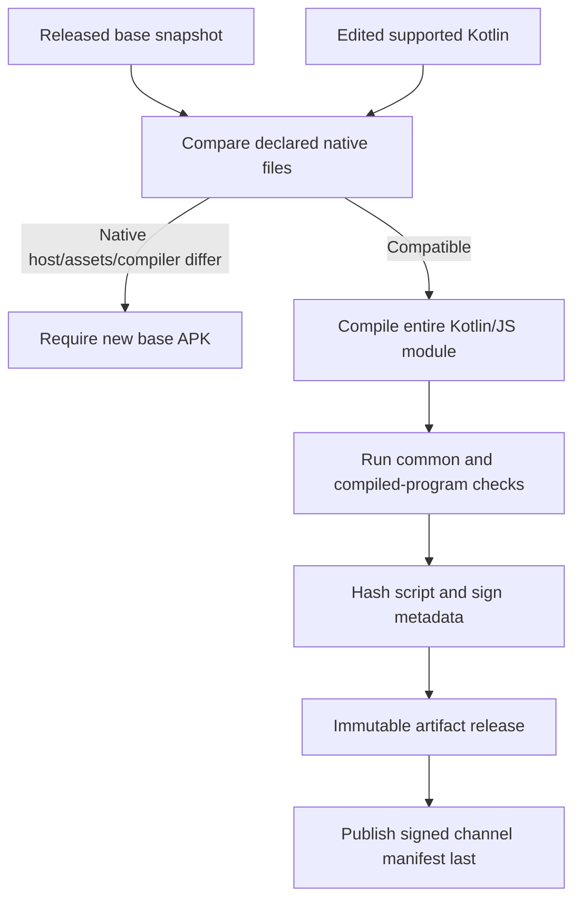
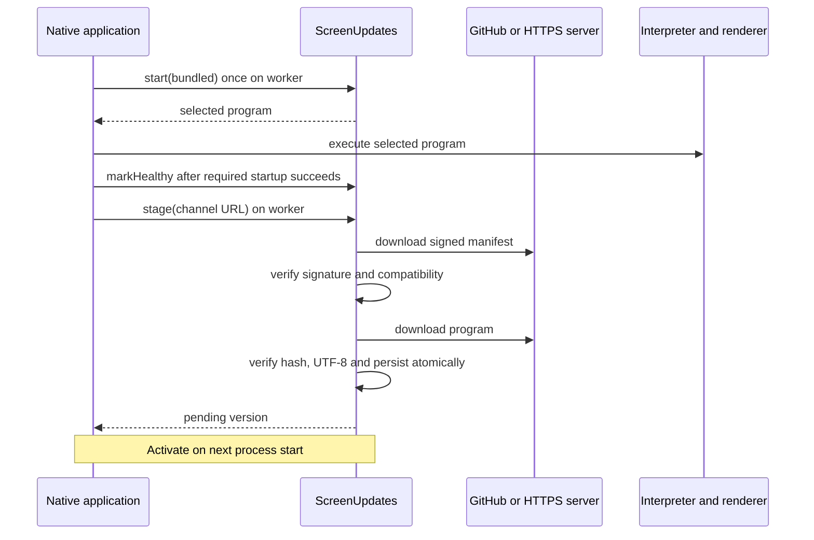
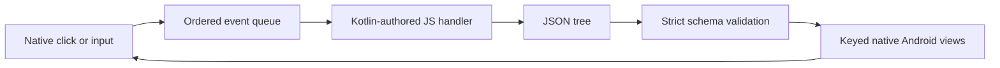
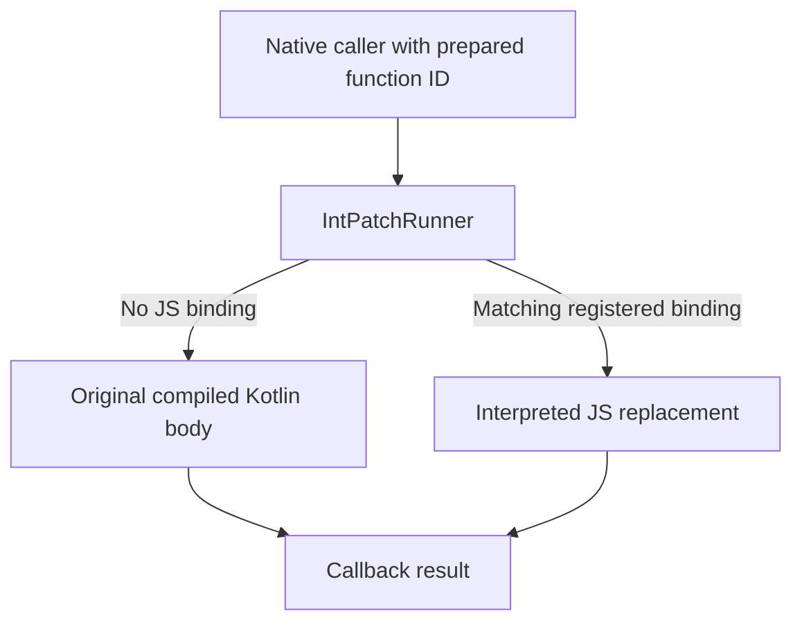

# Architecture and flows

[README](../README.md) · [Integration](integration.md) · [Release workflow](release-workflow.md) · [Verification](production-readiness.md)

Current host: `native-back-v1`, APK 0.4.0. Manifest schema 3, screen API 2, runtime `kotlin-screen-js`. The Back-action extension requires the new host fingerprint; it does not retrofit the older 0.3.0 host.

## Three separate pieces

1. **Native host + SDK:** installed Android code owns widgets, platform callbacks, update storage and the interpreter.
2. **Supported Kotlin module:** compiles to one complete JS program containing screen behavior and selected function replacements.
3. **Release tooling/host:** compares sources against a base, compiles/tests/signs the program and publishes bytes over HTTPS.

The example checkout is a consumer of the SDK. It is not the library API itself. React Native, Flutter, iOS and downloaded DEX/native-library patching are not active targets.

## Build flow

`runtime.json` configures the example app ID, base version, registered screens, channel and native fingerprint inputs. Gradle and Python hash the same sorted path/content map, normalizing text CRLF to LF. The host fingerprint includes installed SDK/host sources, packaged baseline, public key and declared build settings.

The format-3 baseline records native-file hashes, screen-source hashes, host fingerprint and APK/program SHA-256 values. Added, changed or removed native inputs reject a patch build. Changed common Kotlin files are reported, but the **whole module** is compiled. No compiler plugin discovers or rewrites arbitrary functions.

This fingerprint represents declared source/build inputs, not a complete reproducible toolchain or binary APK identity. APK hashes are recorded separately.

## Download and activation

Signature verification authenticates exact payload bytes before metadata is trusted. Metadata binds app ID, base ID, host SHA-256, screen API, runtime, registered screen set, positive patch version, artifact URL and script SHA-256. Storage is scoped by base ID plus host fingerprint. The screen set must match exactly; IDs are not wildcard permissions.

The accepted-version high-water mark rejects replay/downgrade. Script and metadata files are written with `AtomicFile` before pending/accepted state is committed. Interrupted unaccepted files can be overwritten on retry. Persisted metadata and script are authenticated again before execution. This is not one transactional filesystem/database operation.

## Screen execution

`ScreenInterpreter` owns one hidden local WebView, a dedicated Web Worker and a serial request queue. The installed page owns the request channel; downloaded code runs in the worker and has no DOM or access to that channel. Only the installed wrapper dispatches these exports:

| Export | Result |
| --- | --- |
| `renderScreen(screenId)` | JSON screen tree as a string |
| `handleEvent(screenId, action, value)` | Next JSON screen tree as a string |
| `patchedFunctionIds()` | JSON array of function IDs as a string |
| `invokePatch(id, first, second)` | Decimal integer result as a string |

WebView is not the visible UI. The page has an opaque origin: origin-backed storage such as IndexedDB is denied. CSP denies network connections, remote scripts and page content; only the installed inline bootstrap, evaluated code and blob workers are allowed. File/content/network loads and external navigation are also disabled in WebView. Browser permissions, geolocation, file choosers, dialogs and downloads are explicitly denied; no JavaScript-to-Java interface is installed. JS arguments are serialized through the wrapper, not interpolated as raw user code. Signed programs remain untrusted at the output boundary. These measures do not prove isolation from memory exhaustion or provider vulnerabilities.

The 10-second operation timer terminates the worker through the responsive control page before reporting failure. An infinite loop therefore does not need to finish before fallback can run. Browser and Android tests exercise termination followed by a fresh interpreter. A renderer/process or host crash is a separate failure mode; there is no hard per-worker memory quota.

Native HTTPS downloading is separate from WebView execution. The SDK manifest supplies the Internet permission for that transport; the downloaded JS is not granted a general network or Android-service bridge.

Screen events have an action and optional string value. A separate bounded queue coalesces adjacent updates to the same field without crossing click events. Intermediate results are validated but only the latest queued result is displayed, reducing stale text replacement.

## Native function selection

Hooks and matching exports are handwritten. The runner validates unique declared IDs against registered native hooks. The implemented contract is callback-based `(Int, Int) -> Int`, not arbitrary Kotlin objects, native instances or suspend functions. An unpatched call can complete its callback immediately; a JS call completes asynchronously.

The runner does not overwrite native methods or compare source code on the device. JS failure does not silently rerun the original body after possible side effects. It reaches the host's failure/recovery path.

## UI and Back contract

The root contains `screenId`, `type: column`, `children` and optionally `backAction`. Each widget has a stable, globally unique ID.

| Node | Additional fields |
| --- | --- |
| column, row, card | children |
| text | text, style: title/body/caption/error |
| button | text, action, optional enabled |
| input | text label/hint, value, action, optional enabled |
| toggle | text label, action, optional checked/enabled |

Unknown fields/types, duplicate IDs, wrong primitive types and malformed actions fail validation. Limits:

| Boundary | Limit |
| --- | --- |
| Manifest download | 64 KiB |
| Program download | 2 MiB |
| Tree text | 65,536 characters |
| Nodes / depth / children per layout | 128 / 8 / 32 |
| Widget text / input value | 1,024 characters |
| Queued screen events / interpreter requests | 64 each |
| Function bindings | Up to 64 registered IDs |
| Interpreter operation timeout | 10 seconds |
| HTTPS connect/read timeout | 15 / 20 seconds |

Rows distribute width equally; styling/spacing are installed renderer behavior. The renderer reuses views by ID and type, reconciles children, avoids setting identical input text and suppresses callbacks during model updates. Removing/changing a field can lose its focus or cursor.

A validated `backAction` names an ordinary event. `ScreenEngine.back()` dispatches the latest rendered action, consumes Back while a tree update is pending and returns false for native root handling. The host wires legacy Back and Android 13+ platform callbacks; newer callbacks are enabled only for non-root trees and removed on root, failure or destruction. Keyboard Back is handled by Android before page navigation in the verified phone case.

The sample flow maps Details → Cart, Review → Details, Receipt → Cart. Cart has no handler. This is program-managed navigation inside one registered screen, not an Android Navigation/Compose back stack.

## State, health and failure

One application-owned `ScreenUpdates` instance selects the program once per designated process. Activities reuse that selection but own/dispose their interpreters. Closing/recreating the interpreter resets JS globals; patch persistence is different from cart/form persistence.

The demo confirms health only after its first validated native tree attaches and prepared function routes return successfully. This is not proof of all later events or business behavior.

- Unconfirmed patched startup restores previous/bundled code on next start.
- Runtime failure calls `onFailure`; the host must close the engine, run `reject` on a worker and use the selected fallback.
- The demo permits one recovery attempt, including immediate fallback after worker termination on timeout.
- Highest accepted version remains preserved. Repointing the channel to an older patch does not remotely roll devices back; a corrective program needs a newer patch version.
- No recovery undoes database writes, network operations, payments or other external effects.

Saved scripts and manifests are read with bounded `AtomicFile.openRead`, allowing Android to restore an interrupted write's backup before signature/hash verification. Fractional, string and overflowing patch versions are rejected rather than coerced into integers.

All externally supplied JSON passes a length/nesting scan (maximum 32 containers) before recursive parsing; screen-tree depth and widget limits are then validated separately. Length limits alone do not prevent a nested-JSON stack overflow.

Hosts may configure 1–8 trusted public keys. Each saved program is checked against the current trust set on boot; keys are never accepted from a patch. Overlap keys during rotation, then remove revoked keys through a trusted host release. This is not an OTA revocation service.

`disable(bundled)` persists disabled state, clears active/pending/fallback pointers, retains the highest accepted version and returns the bundled program. The host must close the old engine and display that return value. While disabled, staging performs no download. `enable()` allows only newer patches; it never restores disabled versions automatically. These controls require a trusted host decision; no remote control endpoint is provided.

Durable state migration, multi-process coordination, staged rollout/telemetry, independent emergency revocation and broad failure/device coverage remain unfinished. See the [test matrix](production-readiness.md#broader-test-matrix).
