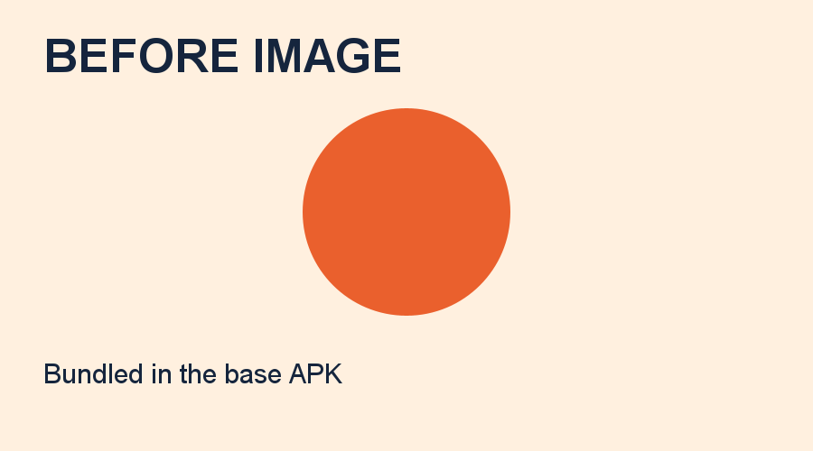

# Visible image asset test

This test adds a real image viewer to the same `dev.patchrelay.demo` app. The existing v0.3.0 base is text-only and cannot display a replacement picture through its String-returning patch interface.

## Setup is separate from the asset update

The prepared v0.4.0 APK has the same package and signing certificate, adds no permission beyond INTERNET, and retains the known `greet(String): String` patch ABI and Kotlin 1.9.23 runtime. Compatibility ID 3 is intentionally retained for the known existing test payloads; the native UI setup is an APK update and is **not** counted as an OTA success. Installing it on the physical phone requires the user's approval because the prior test constraint was to keep the base installed.

The new launcher is `ImageActivity`. Its background worker loads the current signed patch and decodes the displayed image. The base APK contains only `assets/image-before.png`; packaging checks reject an APK that already includes the after-image PNG.




## What changes through GitHub

The viewer stages signed code patch 11 from the `image-assets-test-v1` prerelease. After restart, that code downloads `after.png` separately, requires HTTPS, limits download size, validates a pinned SHA-256 and PNG header, and atomically writes the app-owned `patchrelay-preview.png` cache file. The viewer then decodes and displays those actual cached bytes, with their source and hash visible.

The expected after-image SHA-256 is `4505b1a7c8dbbedcd5b6204d1855fb51bb8f2ac594f8b8b5cef0c8ca2256c3ef`; the before image is `06dccd1583d9812d59160e1bb1186bcda7262c5b32d3b791578ecffa492d8240`.

This is an explicit downloaded-image overlay. It does not mutate the signed APK's original asset, and the current format still does not package images inside a DEX file. Code signature verification authenticates the pinned image URL/hash; the image bytes are checked independently before use. Cache can be cleared by Android. Network I/O failure keeps the existing image and allows a retry after restart without intentionally failing code startup.

The prerelease is deliberately separate from the legacy demo's normal latest-update URL. No physical-phone update has been performed as part of preparation. Emulator and phone observations are recorded separately below when actually verified.

## Reproduce preparation

```powershell
java -Djava.awt.headless=true tools/MakeImageAssets.java
.\tools\build-image-test.ps1 -AndroidSdk $env:ANDROID_HOME
```

The generated test cards are deterministic for the same font renderer and are checked into source. The after-image hash is computed from the actual source PNG during the build and inlined into the signed patch. Output includes the base APK, two PNGs, signed patch DEX and manifest under `dist/image-assets-test-v1/`. Existing manifests are not overwritten.

## Expected phone flow after setup approval

1. Open the updated base. Confirm the orange circle and **Image source: APK baseline**. Record this new base APK's hash and install timestamp; the previous text-only APK hash is not used as the OTA comparison baseline.
2. Tap **Download image update**. Wait for verification.
3. Use **App info — force stop and reopen**, then reopen the same app.
4. Confirm the blue check-mark tile, **Image source: downloaded cache image**, its expected PNG hash, and active code patch 11.
5. Confirm the base APK's hash and install timestamp did not change between steps 1 and 4.
