# Build and publishing workflow

[README](../README.md) · [Integration](integration.md) · [Architecture](architecture.md) · [Verification](production-readiness.md)

The [installable PatchRelay CLI](../cli/README.md) provides `patchrelay init`,
`patchrelay baseline` and `patchrelay patch`, with no Python runtime. It requires
Node 22+, JDK 17, SDK 35 and a prepared project. The Python commands retained
below are legacy tools for this repository's configured example. Neither route
is an automatic integration/compiler plugin for arbitrary native screens.

## What gets published where?

| Artifact | Destination | Current status |
| --- | --- | --- |
| Developer's original APK/AAB with SDK/hooks | Developer's normal Android distribution channel | Demo APKs hosted on GitHub; no Play approval established |
| Signed JS program + manifest | GitHub Releases or personal HTTPS server | Working |
| Signed channel manifest | Stable HTTPS URL polled by installed app | Working, manually published |
| PatchRelay Android library | Module, AAR or local Maven preview | Public Maven Central publication pending; see [Maven guide](maven-publishing.md) |
| CLI | npm `@orbital_mcp/patchrelay`, `alpha` tag | First publication accepted; registry processing pending public availability |
| Source/build tools | Private GitHub | No automatic native integration/compiler plugin |

The SDK is the product; the APK demonstrates/tests it. Publishing an example APK is not publishing the dependency.

With the [Gradle baseline plugin](gradle-integration.md) applied, normal
`assembleRelease`/`bundleRelease` commands now record the actual APK/AAB baseline
automatically. Select its immutable record explicitly when building a patch.
The legacy Python commands below are not required for this normal-build flow.

For multi-build discovery, `patchrelay catalog` creates a signed app/channel
catalog locally while preserving explicitly supplied older-base routes. See
[catalog, hosting and native-upgrade flow](update-routing.md). Automatic remote
upload/catalog replacement is not implemented; selection of baselines and the
previous catalog remains explicit.

## Explicit baseline and patch commands

No command selects a baseline, commit or branch automatically. The developer
chooses the exact release being patched.

Before making screen changes, build and record a base:

```powershell
python tools/screens.py baseline --out dist/my-base-v1
```

`baseline` is the clearer name for the existing `base` command. It builds the
configured demo APK, compiles/tests the supported screen program and saves
`baseline.json`, `screen-base.apk`, `baseline-screen.js` and `baseline-sources.zip`.
The JSON includes native/screen file hashes, APK/program hashes and the source
archive hash. The ZIP preserves the declared native and screen inputs; it is not
a complete project backup, Git history or a signing-key backup. Store the whole
directory in durable private release storage, with an independent backup. `dist/`
is Git-ignored local output, not durable remote storage or automatic cloud backup.
Never upload this private source ZIP in a public patch or Maven release.

After editing supported screen Kotlin, explicitly supply that saved baseline:

```powershell
python tools/screens.py patch --baseline dist/my-base-v1/baseline.json --version 1 --repository YOUR-OWNER/YOUR-REPO --tag my-base-v1-patch-1 --key .keys/patch-signing.key --out dist/my-base-v1-patch-1
```

The command verifies compatibility and archive integrity, compiles the complete
current program and signs the patch. It does not upload or update a catalog.
Keep earlier fixes in current source. Native changes require another base.
Output directories must be empty; existing release records are not overwritten.
Older format-3 records without a source-archive hash remain supported.

If the record was lost, explicitly select the original commit/tag/branch and
provide the actual original released APK:

```powershell
python tools/screens.py recover-baseline --from-ref YOUR-RELEASE-COMMIT --apk C:/releases/original.apk --out dist/recovered-base-v1
```

Recovery resolves only the supplied ref, creates a detached Git worktree under
`.tools/baseline-recovery/`, and runs that revision's existing `base` builder.
It never checks out/resets your active branch or copies private keys into that
worktree. Recovery requires that revision's supported build tool and original
dependencies/toolchain/signing configuration. Local.properties and ignored keys
are not restored automatically; configure Android SDK/JDK paths in the environment.
The recovered APK must match the supplied original APK byte for byte; a different
signing certificate or non-reproducible build is rejected, not guessed compatible.
The recovery worktree/candidate remain private local diagnostic output; no
baseline is copied to the chosen output directory on an APK mismatch.

Without the release record or an exactly reproducible original APK, this tool
cannot establish a trusted baseline. Ship a new native base instead. Older normal
builds without the Gradle plugin did not record baselines; plugin-enabled release
builds now do. These tools still require a prepared screen module, not arbitrary
native screens.

## Current release identities

The block below describes the last published host. Working source/snapshot now target **0.8.0 / code 8 / `native-store-v1`**. Its channel is not published yet. Do not serve the new worker/API program to the old base or overwrite old snapshots/releases.

```text
Base: native-back-v1
Example APK: 0.4.0 / code 4
Manifest schema: 3
Screen API: 2
Runtime: kotlin-screen-js

Immutable artifact release:
https://github.com/jaypal1046/patchrelay/releases/tag/native-back-v1-patch-1

Stable polled channel:
https://github.com/jaypal1046/patchrelay/releases/download/native-back-v1/patch.json
```

The channel JSON in `channels/native-back-v1.json` is a source-history mirror. The app does not fetch that repository file. Older channels remain tied to their older bases; never repoint them to an incompatible program.

## Release flow

```mermaid
flowchart LR
    B[Build native base once] --> I[Install/distribute base]
    I --> K[Edit supported Kotlin]
    K --> T[Compare, compile and test]
    T --> S[Sign new patch version]
    S --> A[Upload immutable artifacts]
    A --> C[Update signed channel pointer]
    C --> D[Device verifies and stages]
    D --> R[Next process start activates]
```



## 1. Create patch signing keys

For a separate application, generate new keys at fresh paths:

```powershell
java tools/Publisher.java keygen .keys/my-app-private.key my-app-public.txt
```

Never commit the private key or bundle it in the app. The demo pins `demo/patch-public-key.txt`; substituting a public key changes the native contract and requires a new base. The builder defaults to `.keys/patch-signing.key`; pass `--key` for another key.

Protect release credentials and private keys; use separate keys for each developer/application. The SDK supports a host-owned set of 1–8 trusted public keys for overlap during rotation. Removal/revocation requires a trusted host release; there is no independent remote revocation service. Never let a patch supply its own trusted keys. Demo APK signing uses a development key and is separate from patch signing.

## 2. Create a native base deliberately

For a new release, allocate a new base ID, APK version/code and channel in `runtime.json`. Set the correct app ID/public key and declared native inputs. These changes intentionally invalidate the previous compatibility snapshot.

For the existing published example, use its released APK/snapshot for compatibility testing. Rebuilding is not a guarantee of the same APK bytes or signing identity.

Current working Kotlin contains the patch, while these fixtures represent the simpler baseline:

- `demo/fixtures/Checkout.v2.baseline.kt`
- `demo/fixtures/Runner.baseline.kt`

The Checkout fixture's filename is historical; it is still the baseline used by the 0.4.0 example.

To create an intentional new base while preserving your working source, start with saved/committed work and no concurrent build editing these files:

```powershell
New-Item -ItemType Directory -Force .tools/base-source-backup | Out-Null
Copy-Item screens/src/commonMain/kotlin/Checkout.kt .tools/base-source-backup/Checkout.kt
Copy-Item screens/src/commonMain/kotlin/Runner.kt .tools/base-source-backup/Runner.kt

try {
    Copy-Item demo/fixtures/Checkout.v2.baseline.kt screens/src/commonMain/kotlin/Checkout.kt
    Copy-Item demo/fixtures/Runner.baseline.kt screens/src/commonMain/kotlin/Runner.kt
    python tools/screens.py base --out dist/my-new-base
    if ($LASTEXITCODE -ne 0) { throw "Base build failed" }
} finally {
    Copy-Item .tools/base-source-backup/Checkout.kt screens/src/commonMain/kotlin/Checkout.kt
    Copy-Item .tools/base-source-backup/Runner.kt screens/src/commonMain/kotlin/Runner.kt
}
```

Use a fresh output directory. The base command runs checks, compiles the original program, updates `demo/src/main/assets/baseline-screen.js`, builds the library/APK and emits:

```text
dist/my-new-base/
  screen-base.apk
  baseline-screen.js
  baseline.json
```

Preserve these exact release artifacts. For that new release, copy its `baseline.json` to `demo/release-baseline.json`. Commit the corresponding bundled asset/config/snapshot together. Never silently replace a snapshot for an already distributed base.

The baseline command's behavior checks are example-specific. A different app/module needs its own assertions and adapted paths before this workflow applies.

## 3. Build a compatible patch

Keep the native base/snapshot unchanged. Edit only supported common Kotlin, then use an unused tag/output directory and increasing version. Example for the first patch on the unreleased storage test base:

```powershell
python tools/screens.py patch --baseline demo/release-baseline.json --out dist/native-store-v1-patch-1 --version 1 --tag native-store-v1-patch-1
```

This command is an example, not a claim that the storage test base or its patch has been published. The last published Back base still has its own patch 1. For another GitHub artifact repository, add `--repository OWNER/REPOSITORY`; use `--key PATH` for its signing key.

The tool:

1. Compares declared native files with the recorded baseline.
2. Reports common Kotlin source changes.
3. Runs Kotlin tests and compiles the whole module.
4. Checks compiled exports, screen/flow behavior and function routing.
5. Rechecks native compatibility and rejects unchanged compiled output.
6. Copies `screens.js` and signs `patch.json`.

It does not overwrite signed/base outputs. Patch version must be positive and newer than versions already accepted by devices; the builder does not query device high-water marks for you.

The output program is complete, not a per-method binary delta. Do not copy its JS into the APK asset or rebuild/reinstall the APK to prove an OTA patch.

## 4. Publish immutable artifacts first

Create release notes in a local UTF-8 file. For a fresh GitHub release/tag:

```powershell
.\tools\publish-github.ps1 -Repository jaypal1046/patchrelay -Tag native-store-v1-patch-1 -NotesFile .tools/patch-1-notes.md -PreRelease -Files @(
    'dist/native-store-v1-patch-1/screens.js',
    'dist/native-store-v1-patch-1/patch.json'
)
```

The notes file must exist. Use your own repository/tag in a real application. The helper uses `GITHUB_TOKEN` or Git Credential Manager, creates a draft, uploads all supplied files and publishes after uploads succeed. A failed upload can leave a draft for inspection. It creates new releases; it does not update an existing channel or replace existing tags.

Keep published versioned artifacts immutable. The manifest's signed artifact URL must match where `screens.js` is actually uploaded. A prerelease here still becomes publicly downloadable; it is not a private preview/rollout mechanism.

## 5. Publish the channel manifest last

After checking artifact availability, publish the **exact signed** `patch.json` at the channel URL embedded in the APK. For the working storage test base, that is the `native-store-v1` release asset named `patch.json`; this channel has not been published. Leave the old `native-back-v1` channel unchanged.

- First channel release: the same publish helper can create it with only the signed manifest as an asset.
- Existing channel: replace its manifest through GitHub Releases/API. The helper has no update-channel command.
- Keep an audit copy in `channels/` after successful publication.
- Do not edit decoded payload fields or URLs after signing. Changing them invalidates the signature.
- Stage/verify on a test device before relying on the release.

GitHub asset replacement is not an atomic pointer update: deleting/renaming an asset can briefly return 404, and caches can delay visibility. Upload/verify the replacement before removing the old asset where possible. A failed check must leave the active program usable and permit retry; interrupted-device behavior still needs broader fault testing.

For a personal server, serve the channel and signed artifact from HTTPS URLs, without embedded URL credentials. Sign the correct final artifact URL. The SDK has no authenticated/private-host credential flow. The current builder generates GitHub artifact URLs; personal-server publishing requires adapting that URL generation/signing workflow rather than passing an undocumented host flag. Configure the server channel URL in the native release before shipping its APK.

The existing Java signer can sign an already checked/built program for your server. After adapting the base's channel URL and building against that base, this PowerShell fragment creates a **fresh** server manifest:

```powershell
$base = Get-Content demo/release-baseline.json -Raw | ConvertFrom-Json
java tools/Publisher.java sign .keys/patch-signing.key dist/native-store-v1-patch-1/screens.js $base.appId $base.baseVersion 1 ($base.screenIds -join ',') https://updates.example.com/releases/patch-1/screens.js dist/native-store-v1-patch-1/server-patch.json $base.hostSha256
```

Replace the example domain/paths/version/key with your own. Upload the matching `screens.js` to that exact signed URL, then serve the bytes of `server-patch.json` as the channel's `patch.json`. The signer calculates the script hash but does not run screen tests; do not use it to bypass compatibility/build checks. The existing GitHub demo will keep polling GitHub until a new host is configured for your server.

## 6. Verify on device

Check the bundled baseline before downloading. Record installed APK hash/version/install times. Then stage the signed program, restart the process, verify expected UI/function behavior, and compare the installed APK/hash/timestamps again. A second restart checks healthy selection persistence.

With `patchrelay.catalogUrl` configured, the new demo checks once per process on
a worker after healthy first rendering. Manual controls remain test tools.
Periodic scheduling/restart UX is not implemented; Force-stop/reopen remains a
controlled test procedure, not an instruction the SDK forces on end users.

## Corrective releases and common failures

| Symptom | Meaning / next action |
| --- | --- |
| Native compatibility rejected | Inspect changed SDK/host/assets/build inputs; create a new base if intentional |
| Invalid signature/hash/UTF-8 | Stop publication/use; check key, exact signed bytes and artifact integrity |
| Incompatible app/base/API/IDs | Use artifacts built for the installed host and exact registered screen set |
| HTTP 404 | Check channel asset, immutable artifact URL, publication order and caching |
| No newer version | Accepted version is at least as high; publish a newer corrective version |
| Screen/interpreter failure | Host recovery must reject/fallback; worker timeout terminates execution before fallback |
| Missing native widget/hook/capability | Requires native release; a screen patch cannot add it |

Pointing the channel backward is not remote rollback: accepted-version protection prevents downgrades. Publish corrected/previous-good supported code under a **newer** version. Fallback does not reverse persistent data or external side effects.

## Publishing the dependency itself

Buildable local artifact today: `sdk/build/outputs/aar/sdk-release.aar`. There is no published `dev.patchrelay:android:VERSION` coordinate and no configured Maven publication task.

Maven Central is the planned public dependency destination. A local Maven preview now includes the AAR and dependency metadata; see [Maven distribution](maven-publishing.md). Verified namespace ownership, distribution license, signing, Central upload and a separately tested consumer app remain pending. No SDK version is publicly available yet.

The original app and SDK must meet their distribution channel's rules. Interpreted patches are not a blanket approval exemption; see [distribution and security](production-readiness.md#distribution-and-security).

## Private GitHub hosting

The demo channel can be overridden with `patchrelay.manifestUrl` in ignored
`local.properties` or with `-Ppatchrelay.manifestUrl=...`; see
[host configuration](integration.md#choose-your-patch-host-in-localproperties).
This supplies a URL, not authentication or an automatic patch-upload destination.

The repository is now private. The current downloader is unauthenticated; private repository release URLs are not anonymously readable. Existing release/source links require repository access. Use a separately designed authenticated delivery gateway or an accessible HTTPS artifact host before relying on private release delivery. Keep GitHub credentials on trusted infrastructure; do not ship a broad repository token in the APK, JS or manifest. The public GitHub API smoke test does not validate private release downloads.
